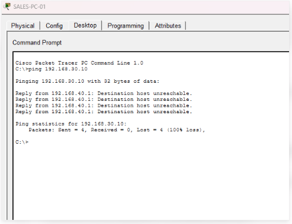
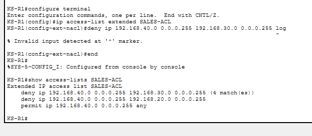

# INV-001 — Unauthorised Sales-to-HR Access Attempt

## Investigation Summary

**Environment:** KS Technologies (Simulated Enterprise)  
**Investigation ID:** INV-001  
**Status:** Closed — Control Verified  
**Severity:** Low (Controlled Lab Simulation)  
**Source:** SALES-PC-01 (192.168.40.10)  
**Destination:** HR-PC-01 (192.168.30.10)  
**Protocol:** ICMP

## Scenario

A simulated workstation in the Sales department attempted to communicate with a restricted HR workstation.

The purpose was to validate network segmentation and determine whether unauthorised traffic could be detected through centralised monitoring.

## Evidence Collected

- Four ICMP echo requests were sent from SALES-PC-01.
- All four attempts failed.
- The router returned "Destination host unreachable".
- The SALES-ACL deny rule recorded four matches.
- The ACL configuration remained unchanged following testing.

### Evidence 1 — Blocked Sales-to-HR Connection

The Sales workstation attempted to ping the HR workstation.
All four requests failed, demonstrating that network segmentation
prevented the connection.

### Evidence 2 — ACL Deny Counter

The router's SALES-ACL recorded four matches against the
Sales-to-HR deny rule, confirming that the traffic was blocked.

## Investigation Findings

The network segmentation control successfully prevented Sales-to-HR communication.

ACL match counters provided evidence that traffic matched the configured deny rule.

However, the Packet Tracer environment did not support the attempted ACL logging configuration.

No automatic security alert was demonstrated for these denied connections.

## Detection Gap

Centralised Syslog collection is operational for supported network device events.

However, blocked traffic was not automatically recorded as a security detection event.

An analyst currently needs to inspect ACL counters manually to identify this activity.

## Recommended Improvements

1. Implement ACL deny-event logging on supported network equipment.
2. Forward relevant security events to a central SIEM.
3. Develop detection rules for repeated denied connections.
4. Establish alert severity and investigation procedures.
5. Correlate network activity with endpoint and authentication logs.

## Conclusion

The preventive network control operated successfully.

The investigation identified a gap between preventing unauthorised access and automatically detecting suspicious behaviour.

**Final outcome:** Access blocked; preventive control verified; automated detection improvement recommended.